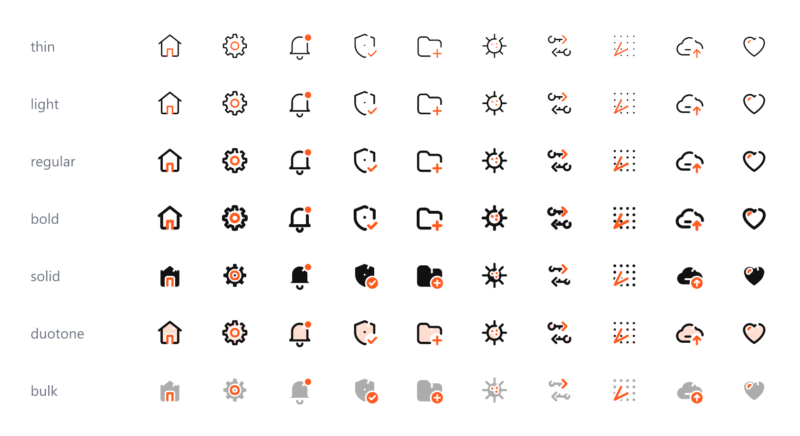
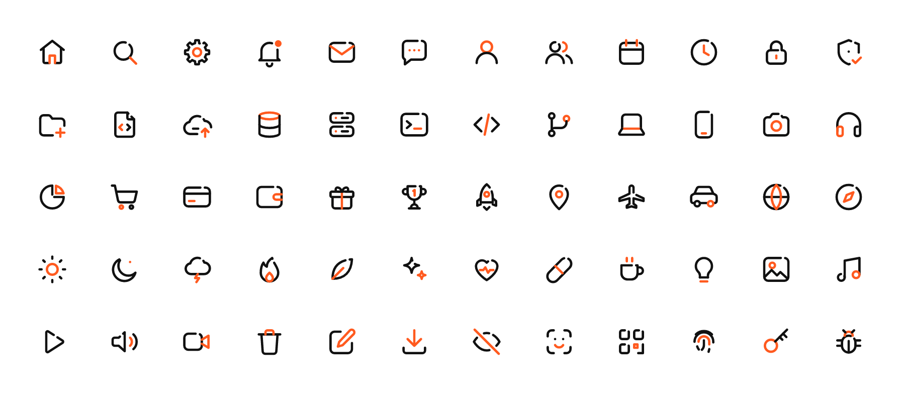
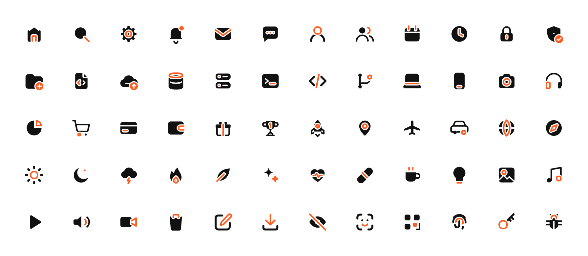
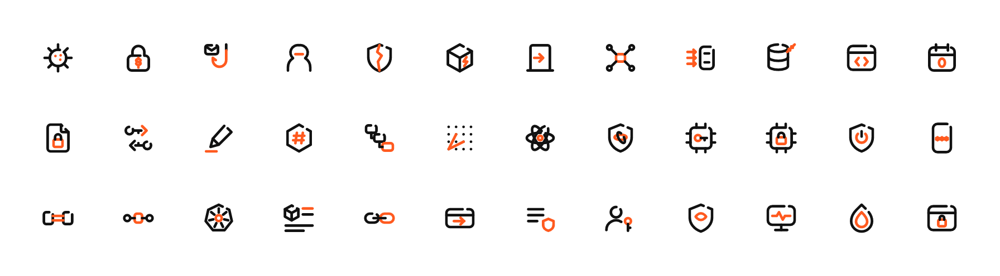

# DevX Icons

**7,418 open-source icons with the open-loop signature: line in four weights, solid, duotone, bulk, and animated.**

[](https://github.com/Kalyan-Deva/devx-icons/releases/latest)


**[Browse all 7,418 icons →](https://kalyan-deva.github.io/devx-icons/)** search, switch style and weight, turn on animation, pick your accent colour, click to copy.





## Why DevX

- **Open loop, the signature.** Every closed outline opens at 1 o'clock with the same 1.5 px
  gap; solid, duotone and bulk carry a matching notch. You can spot a DevX icon at a glance.
- **A built-in accent.** One detail per icon follows `--devx-accent` (falling back to
  `currentColor`): set one CSS variable and the whole set picks up your brand colour.
- **Security & infrastructure coverage nobody else has**: threats (malware, phishing,
  exploit, DDoS, SQL injection, zero-day…), cryptography (key exchange, lattice,
  post-quantum, HSM, TPM, secure boot…) and infrastructure (VPN, WAF, SBOM, supply chain,
  SIEM, onion routing…), each with all sixteen variants.
- **Eight styles from one geometry**, so they always match: line in thin / light / regular /
  bold, solid, duotone, bulk, and animated.
- **Motion by rule.** Gears spin, bells swing, hearts beat, arrows nudge in their own
  direction, badges pop, everything else draws its accent in. Respects `prefers-reduced-motion`.
- **Every format**: SVG, sprites, icon fonts, React, Vue, Svelte, web component, Iconify,
  Android, PNG and ICO.



## Download

Grab a ready-made pack from the [latest release](https://github.com/Kalyan-Deva/devx-icons/releases/latest):

| Pack | What's inside |
|---|---|
| `devx-icons-1.2.0-svg.zip` | every icon in `line/ thin/ light/ bold/ solid/ duotone/ bulk/ animated/`, sprites, `icons.json` |
| `devx-icons-1.2.0-font.zip` | icon fonts: regular, thin, light, bold, solid (+ bulk via CSS), woff2 + ttf, `devx-icons.css` |
| `devx-icons-1.2.0-png.zip` | PNG at 16, 24, 32, 48, 64, 128, 256 px in line, solid, duotone and bulk |
| `devx-icons-1.2.0-ico.zip` | one multi-size `.ico` per icon (16–256 px) in line, solid, duotone and bulk |
| `devx-icons-1.2.0-android.zip` | Android vector drawables, line + solid, theme-coloured |
| `kalyan-dev-devx-icons-*.tgz` | the npm packages as tarballs: `@kalyan-dev/devx-icons` and `-font`, `-react`, `-vue`, `-svelte`, `-elements`, `-iconify` |

## Styles

| Style | What it is | Where |
|---|---|---|
| line | 1.75 stroke, adjustable | everywhere |
| thin · light · bold | 1 · 1.25 · 2.25 stroke | SVG folders, fonts, Iconify, `weight` prop |
| solid | filled bodies, details knocked out, open-loop notch | everywhere |
| duotone | the line icon over a 20 % accent tint | SVG, sprites, components, Iconify, PNG/ICO |
| bulk | solid body at 35 %, accent at full strength | SVG, sprites, components, Iconify, font (`devx-bulk`), PNG/ICO |
| animated | rule-based motion, self-contained CSS | `animated/` SVGs, `animate` prop / attribute |

## Icons


584 hand-drawn base icons × systematic variants (`-plus`, `-minus`, `-check`, `-x`,
`-alert`, `-clock`, `-lock`, `-search`, `-star`, `-heart`, `-upload`, `-download`,
`-edit`, `-bolt`, `-off`, `-dot`) = **7,418 icons** in 23 categories:

| Category | Bases | Icons | | Category | Bases | Icons |
|---|---:|---:|---|---|---:|---:|
| actions | 18 | 146 | | interface | 41 | 537 |
| arrows | 62 | 62 | | maps | 26 | 435 |
| business | 27 | 459 | | media | 26 | 298 |
| communication | 23 | 391 | | objects | 27 | 459 |
| **cryptography** | 18 | 299 | | people | 15 | 255 |
| development | 25 | 425 | | **security** | 25 | 425 |
| devices | 36 | 612 | | shapes | 14 | 126 |
| editor | 32 | 48 | | status | 27 | 27 |
| files | 30 | 510 | | **threats** | 24 | 408 |
| food | 10 | 170 | | time | 12 | 204 |
| health | 16 | 272 | | weather | 29 | 493 |
| **infrastructure** | 21 | 357 | | | | |

## Use

```bash
npm i @kalyan-dev/devx-icons-react      # React
npm i @kalyan-dev/devx-icons-vue        # Vue 3
npm i @kalyan-dev/devx-icons-svelte     # Svelte
npm i @kalyan-dev/devx-icons-elements   # <devx-icon> web component
npm i @kalyan-dev/devx-icons-font       # icon font
npm i @kalyan-dev/devx-icons-iconify    # Iconify JSON
npm i @kalyan-dev/devx-icons            # raw SVGs + sprites
```

### React — `@kalyan-dev/devx-icons-react`

```tsx
import { HomeIcon, HomeSolidIcon, HomeDuotoneIcon, HomeBulkIcon, SettingsIcon } from "@kalyan-dev/devx-icons-react";

<HomeIcon />                               // line, 24px, currentColor, regular weight
<HomeIcon weight="thin" size={20} />       // thin | light | regular | bold (or strokeWidth)
<HomeDuotoneIcon accent="#ff5a1f" />
<HomeBulkIcon title="Home" />              // accessible; otherwise aria-hidden
<SettingsIcon animate />                   // built-in motion (this one spins)
```

Four components per icon (`<Name>Icon`, `<Name>SolidIcon`, `<Name>DuotoneIcon`,
`<Name>BulkIcon`), tree-shakeable and typed.

### Vue — `@kalyan-dev/devx-icons-vue`

```vue
<script setup>
import { DevxIcon, dxHome, dxBellDot } from "@kalyan-dev/devx-icons-vue";
</script>
<template>
  <DevxIcon :icon="dxHome" variant="duotone" weight="light" />
  <DevxIcon :icon="dxBellDot" accent="#e11d48" animate />
</template>
```

### Svelte — `@kalyan-dev/devx-icons-svelte`

```svelte
<script>
  import { DevxIcon, dxHome } from "@kalyan-dev/devx-icons-svelte";
</script>
<DevxIcon icon={dxHome} variant="bulk" size={28} />
```

### Web component — `@kalyan-dev/devx-icons-elements` (any framework, or none)

```html
<script type="module">
  import { register, dxHome, dxShieldCheck } from "@kalyan-dev/devx-icons-elements";
  register(dxHome, dxShieldCheck);
</script>
<devx-icon icon="home" variant="duotone" animate></devx-icon>
<devx-icon icon="shield-check" variant="solid" size="32" accent="#16a34a"></devx-icon>
```

`@kalyan-dev/devx-icons-elements/all` registers every icon at once (large).

### Iconify — `@kalyan-dev/devx-icons-iconify`

Seven icon sets: `devx`, `devx-thin`, `devx-light`, `devx-bold`, `devx-solid`,
`devx-duotone`, `devx-bulk` (`json/<prefix>.json`), for Iconify, UnoCSS and Tailwind plugins.

### SVG — `@kalyan-dev/devx-icons`

```html

<svg width="24" height="24"><use href="devx-icons/sprite/devx-line.svg#devx-home" /></svg>
```

Inline SVGs get `currentColor` and the accent variable. The line sprite reads
`--devx-stroke-width`. `icons.json` lists every icon with category, tags, base, variant and
animation.

### Icon font — `@kalyan-dev/devx-icons-font`

```html
<link rel="stylesheet" href="@kalyan-dev/devx-icons-font/devx-icons.css" />
<i class="devx devx-home"></i>           <!-- regular -->
<i class="devx-thin devx-home"></i>      <!-- also devx-light, devx-bold -->
<i class="devx-solid devx-home"></i>
<i class="devx-bulk devx-home"></i>
```

The accent is a second glyph layered on top via `::after` in `var(--devx-accent)`.

### Android

Copy `line/` or `solid/` drawables from the Android zip into `res/drawable/`. Ink follows
`?attr/colorControlNormal`, the accent follows `?attr/colorAccent`.

### Accent colour (all formats)

```css
:root { --devx-accent: #ff5a1f; }            /* everywhere */
.danger { --devx-accent: #e11d48; }          /* per area */
:root { --devx-accent: currentColor; }       /* single-colour icons */
```

### PNG and ICO

Every icon in line, solid, duotone and bulk at 16–256 px, plus one multi-size `.ico` each.
Default ink `#111111`, accent `#ff5a1f`; re-render with your colours:

```bash
pnpm build:raster --ink=#ffffff --accent=#22d3ee
```

## Build

```bash
pnpm install
pnpm build          # generate all styles, fonts, sprites, React/Vue/Svelte/elements/Iconify, Android
pnpm build:raster   # PNG + ICO
pnpm release        # zips + npm tarballs in release/ (nothing is published)
pnpm check          # typecheck + tests
pnpm sheets         # QA contact sheets in build/sheets/ (--styles=line,solid,duotone,bulk)
```

### How it works

- `source/<category>.ts` — the hand-drawn base icons in a small DSL (`C` circle, `R` rect,
  `P` polyline, `a()` accent, `dirs()` four rotations, `mirror()`).
- `packages/core` — exact path geometry (arc → cubic, Bézier splitting), the open-loop cut,
  variant badges and gap cuts, motion rules, SVG rendering. Browser-safe, no dependencies.
- `scripts/generate.ts` — expands bases × variants, builds solid with Skia PathKit booleans,
  refits outlines to compact cubics, validates every icon, writes all eight styles.
- `scripts/lib/runtime.js` — one tiny renderer shared by React, Vue, Svelte, the web component
  and the site, so every format draws identical SVG.
- `scripts/build-font.ts` — five fonts with stable code points (`packages/font/codepoints.json`,
  keep it committed): base glyphs in U+E000… then U+F0000…, accent glyphs in U+100000….

## Adding an icon

Add an entry to the right `source/*.ts` file, run `pnpm check-names` and `pnpm build`, and
check it in the preview and in `pnpm sheets`. The generator fails on name collisions, empty
shapes and anything outside the safe area.

## License

MIT © 2026 Kalyan Gopalam
